# M2 40pin Control Demo

**English** | [简体中文](README.zh-CN.md)

M2 40pin Control Demo is an Android peripheral-validation app for the **Quectel M2 (RK3576) 40-pin header**. It brings GPIO, I²C sensor HAT, UART, SPI OLED, and LC29H GNSS tests into one app and displays operation results, status, and errors.

> **Quectel M2 only.** GPIO numbers, device nodes, HAT wiring, and privileged `m2hw` access are specific to the M2 system.

## Features

| Page | Function |
|---|---|
| GPIO | Read a mapped GPIO; hold one pin high/low; release one pin; use ALL UP / ALL DOWN to set all mapped GPIOs high or low; release all outputs |
| I²C | Read BME280, TSL2591, LTR390, SGP40, and ICM-20948 sensors on the Environment Sensor HAT |
| UART | Select a device node and baud rate to send/receive UTF-8 text or receive only |
| SPI | Display text, run a demo, or clear the 2.23-inch SSD1305 OLED |
| GPS | Read LC29H NMEA data and parse fix, satellite count, altitude, HDOP, speed, and course; preview a fix on an online OpenStreetMap page |

## Project structure and data flow

```text
M2ControlDemo/
├── app/
│   ├── build.gradle.kts
│   └── src/
│       ├── main/
│       │   ├── java/com/quectel/m2controldemo/
│       │   │   ├── MainActivity.kt       UI, page setup, results, and map preview
│       │   │   ├── HardwareAccess.kt     Privileged helpers, workers, and resource lifecycle
│       │   │   ├── HardwareInput.kt      M2 pin map, validation, and byte encoding
│       │   │   └── GpsNmeaParser.kt      NMEA checksum and fix parsing
│       │   ├── cpp/
│       │   │   ├── board_io.c            GPIO, I²C, UART, GPS, and generic SPI helper
│       │   │   ├── sensor_hat.c          Environment Sensor HAT SDK wrapper
│       │   │   └── oled_hat.c            SSD1305 OLED SDK wrapper
│       │   ├── res/                      Layouts, icons, colors, and UI strings
│       │   └── assets/                   Helpers generated and packaged by Gradle
│       └── test/                         JVM tests for input validation and NMEA parsing
├── demo-40Pin-HAT/                       Required Quectel HAT SDK source trees and license
├── gradle/libs.versions.toml
└── gradlew.bat
```

One-shot hardware operations follow this path:

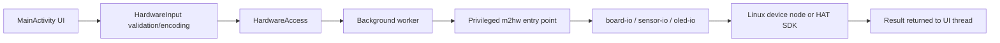

The Activity does not directly open `/dev/gpiochip*`, `/dev/i2c-*`, `/dev/tty*`, or `/dev/spidev*`. It validates input and delegates operations to `HardwareAccess`. One-shot commands run on a single-thread executor and return `Result<String>` to the main thread. GPS uses a dedicated reader executor for its continuous serial stream.

## Privileged M2 hardware access

The app copies `board-io`, `sensor-io`, and `oled-io` from APK assets into `/data/local/tmp/m2controldemo/`, marks them executable, and runs them through the M2 system's `m2hw` channel. The key process launch is:

```kotlin
private fun startRootProcess(command: String): Process {
    val process = ProcessBuilder("m2hw", "0", "sh", "-c", command)
        .redirectErrorStream(true)
        .start()
    processes.add(process)
    return process
}
```

The app does not invoke `su`. The system image must authorize this app through the `m2hw` allowlist and provide the required drivers and device nodes. Installing the APK on ordinary Android does not grant these hardware permissions.

Errors are surfaced rather than converted to success: timed-out processes are stopped, and unexpected output or non-zero exit codes are reported to the UI. Long-running helpers have explicit stop paths. `HardwareAccess.close()` stops GPS, releases held GPIO processes, and shuts down its executors.

## GPIO: M2 pin map, outputs, and release

The M2 physical-pin to Linux global-GPIO mapping is stored in `HardwareInput.m2Pins`. The app currently maps 28 GPIO pins:

| Header pin | GPIO | Header pin | GPIO |
|---:|---:|---:|---:|
| 3 | 140 | 5 | 141 |
| 7 | 79 | 8 | 72 |
| 10 | 73 | 11 | 78 |
| 12 | 87 | 13 | 70 |
| 15 | 71 | 16 | 132 |
| 18 | 134 | 19 | 82 |
| 21 | 83 | 22 | 76 |
| 23 | 85 | 24 | 84 |
| 26 | 81 | 27 | 97 |
| 28 | 96 | 29 | 93 |
| 31 | 92 | 32 | 77 |
| 33 | 91 | 35 | 86 |
| 36 | 90 | 37 | 95 |
| 38 | 88 | 40 | 89 |

The global GPIO number is split into chip and line like this:

```kotlin
fun gpioForPin(raw: String): Pair<Int, Int> {
    val pin = decimal("Physical pin", raw, 1, 40)
    val gpio = m2Pins[pin]
        ?: throw IllegalArgumentException("Pin $pin is not a supported M2 GPIO")
    return (gpio / 32) to (gpio % 32)
}
```

For example, global GPIO 140 is line 12 on `/dev/gpiochip4`. Power and ground pins are not in the map and cannot be operated as GPIOs.

The Activity validates the physical pin before calling the hardware layer:

```kotlin
private fun setGpioOutput(high: Boolean) {
    runOperation {
        val pin = HardwareInput.decimal("Physical pin", textOf(R.id.gpio_pin), 1, 40)
        val (chip, line) = HardwareInput.gpioForPin(pin.toString())
        hardware.setGpio(pin, chip, line, high)
    }
}
```

The native helper requests a line through the GPIO character-device ioctl API. On success it prints `READY` and keeps the process alive. Holding the process keeps the line request (and output level) active; closing it releases the line:

```c
line_fd = request_gpio_v2(chip_fd, line, output, initial_value);
if (line_fd < 0) {
    line_fd = request_gpio_v1(chip_fd, line, output, initial_value);
}
if (line_fd < 0) {
    report_errno("request GPIO line (v2 and v1)");
    goto done;
}

if (output) {
    char buffer[256];
    if (fputs("READY\n", stdout) == EOF || fflush(stdout) == EOF) {
        report_errno("stdout");
        goto done;
    }
    for (;;) {
        ssize_t count = read(STDIN_FILENO, buffer, sizeof(buffer));
        if (count == 0) break;
        if (count < 0 && errno == EINTR) continue;
        if (count < 0) {
            report_errno("stdin");
            goto done;
        }
    }
}
```

`HardwareAccess` waits for `READY` and stores the process. Releasing the output closes the helper's stdin and waits for it to exit. ALL UP / ALL DOWN uses the same mechanism for all 28 lines, asks for confirmation first, and releases lines already claimed if a later request fails.

**Safety:** Bulk operations change the electrical level of all 28 mapped GPIOs. Disconnect external circuits that could be damaged, and verify pin direction, voltage, and wiring first. Use RELEASE ALL to return requested lines to the system.

### Result screenshots

1. 40-pin peripheral wiring

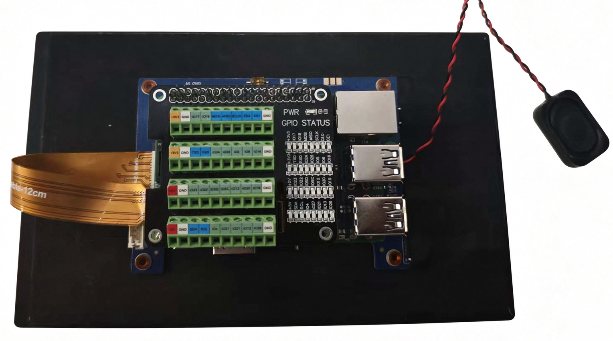

2. Set all GPIO pins low

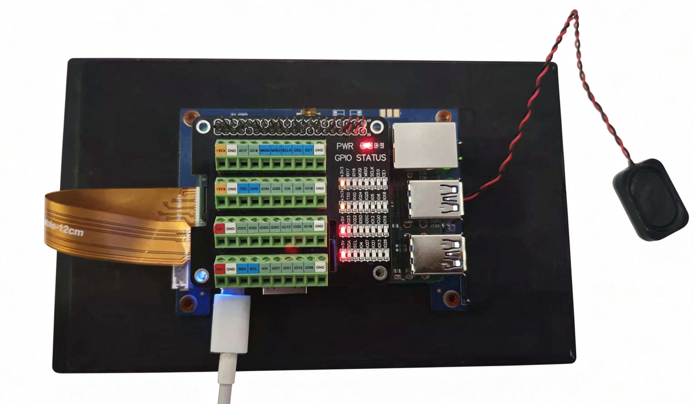

3. Set all GPIO pins high

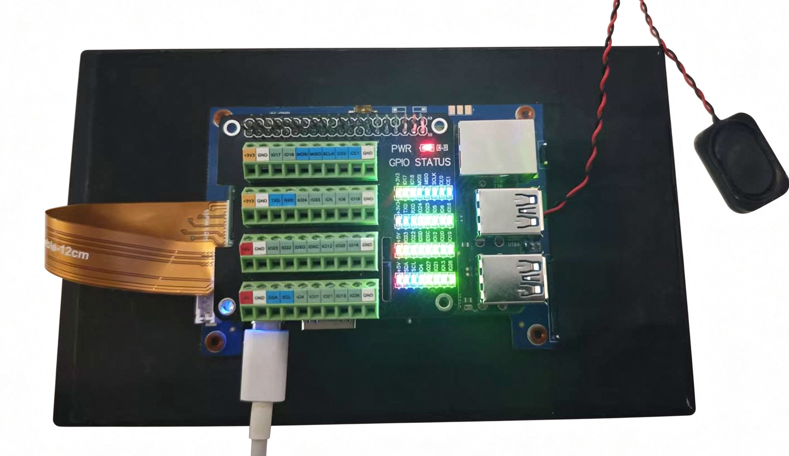

## I²C: Environment Sensor HAT

The I²C page reads the known Environment Sensor HAT (M2 uses bus 3); it is not a general I²C address scanner or register editor.

| Device | Data shown |
|---|---|
| BME280 | Temperature, humidity, pressure |
| TSL2591 | Illuminance |
| LTR390 | Raw UV reading |
| SGP40 | Raw VOC value and read status |
| ICM-20948 | Acceleration, gyroscope, and, when available, attitude and magnetometer |

`sensor_hat.c` initializes and samples the sensors through the HAT SDK, then emits a `key=value` protocol parsed by Kotlin. Kotlin checks required fields and device status instead of inventing values when fields are missing. Example output:

```text
pressure=1008.42
temperature=24.18
humidity=42.30
lux=87
uv=13
voc_status=ok
voc=12345
imu_status=ok
accel_x=...
gyro_x=...
roll=...
```

Kotlin splits each output line at its first `=` and checks required keys. This small protocol keeps the C helper separate from UI formatting:

```kotlin
val values = output.lineSequence().mapNotNull { line ->
    val separator = line.indexOf('=')
    if (separator <= 0) null
    else line.substring(0, separator) to line.substring(separator + 1)
}.toMap()
val requiredKeys = listOf(
    "pressure", "temperature", "humidity", "lux", "uv", "voc_status", "imu_status"
)
val missing = requiredKeys.filterNot(values::containsKey)
if (missing.isNotEmpty()) {
    throw IOException("Incomplete sensor data: ${missing.joinToString()}")
}
```

VOC / IMU may independently report `read_failed`, `not_detected`, `initialization_failed`, or `mag_unavailable`. SDK debug output is kept separate from machine-readable data, and all exit paths call `DEV_ModuleExit()`. `board_io.c` also contains generic I²C read/write commands, but they are not connected to the app UI.

### Result screenshots

1. Peripheral wiring

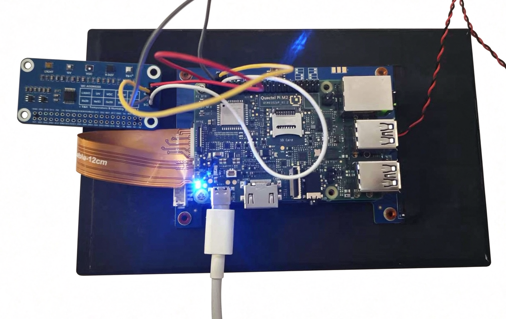

2. I²C sensor readings

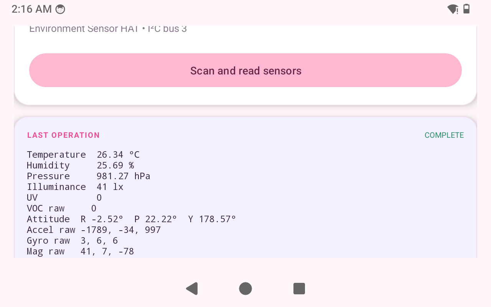

## UART: send, receive, and loopback testing

Kotlin validates the UART device node and baud rate. It restricts serial paths to `/dev/tty...` and converts the payload to hexadecimal before passing it to the native helper:

```kotlin
val device = HardwareInput.uartDevice(textOf(R.id.uart_device))
val baud = parseBaudRate()
val payload = textOf(R.id.uart_message).toByteArray(Charsets.UTF_8)
require(payload.isNotEmpty()) { "Enter a message to send" }
hardware.transferUart(device, baud, 1800, HardwareInput.toHex(payload))
```

Receive-only uses the same hardware layer with no TX payload and a 5-second UI timeout. The helper temporarily configures raw 8N1. It saves the original termios settings, restores them on exit, and closes the file descriptor:

```c
if (tcgetattr(fd, &original) != 0) {
    report_errno("tcgetattr");
    goto done;
}
configured = original;
cfmakeraw(&configured);
configured.c_cflag |= CLOCAL | CREAD;
configured.c_cflag &= ~(CSTOPB | PARENB | CSIZE);
configured.c_cflag |= CS8;
if (cfsetispeed(&configured, speed) != 0 ||
    cfsetospeed(&configured, speed) != 0) {
    report_errno("set UART speed");
    goto done;
}
restore_needed = 1;
if (tcsetattr(fd, TCSANOW, &configured) != 0) {
    report_errno("tcsetattr");
    goto done;
}

done:
    if (restore_needed && have_original &&
        tcsetattr(fd, TCSANOW, &original) != 0) {
        report_errno("restore termios");
        result = 1;
    }
    if (fd >= 0) close(fd);
```

The helper returns received bytes as `RX=<HEX>`. Kotlin validates and decodes the response, then displays HEX and readable text. A physical loopback test connects **header pin 8 (TX) to pin 10 (RX)**. While GPS occupies `/dev/ttyS1`, the app refuses UART tests on that same node.

### Result screenshots

1. UART loopback test (short pins 8 and 10)

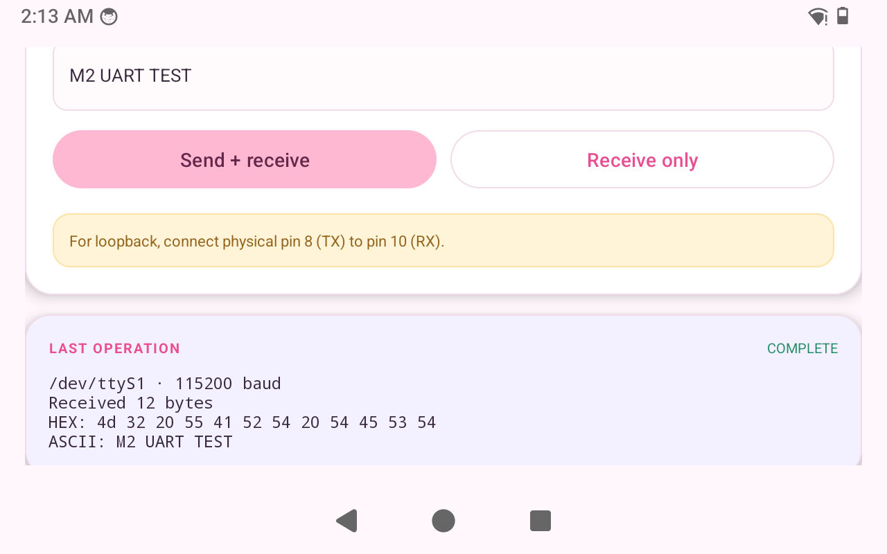

## GPS: LC29H, NMEA parsing, and map preview

The default serial device is `/dev/ttyS1` at 115200 baud. GPS is a continuous stream: the hardware layer starts `board-io gps-stream DEVICE BAUD` and only reports success after receiving `GPS_READY`. The C helper configures raw 8N1 and emits complete NMEA lines; it restores the original termios settings and closes the serial fd when stopped.

`GpsNmeaParser` checks the `$...*HH` checksum before parsing GGA and RMC sentences. The checksum validation is:

```kotlin
private fun checkedFields(sentence: String): List<String>? {
    if (!sentence.startsWith('$')) return null
    val star = sentence.lastIndexOf('*')
    if (star <= 1 || star + 3 != sentence.length) return null
    val expected = sentence.substring(star + 1).toIntOrNull(16) ?: return null
    var checksum = 0
    for (index in 1 until star) checksum = checksum xor sentence[index].code
    if (checksum != expected) return null
    return sentence.substring(1, star).split(',')
}
```

NMEA coordinates use degrees plus minutes and are converted to decimal degrees. The parser also validates minutes, coordinate bounds, and hemisphere:

```kotlin
private fun coordinate(value: String, hemisphere: String, latitude: Boolean): Double? {
    val raw = value.toDoubleOrNull()?.takeIf(Double::isFinite) ?: return null
    if (raw < 0) return null
    val degrees = floor(raw / 100.0)
    val minutes = raw - degrees * 100.0
    if (minutes !in 0.0..<60.0) return null
    val limit = if (latitude) 90.0 else 180.0
    if (degrees > limit || (degrees == limit && minutes != 0.0)) return null
    val direction = hemisphere.uppercase()
    if (latitude && direction !in setOf("N", "S")) return null
    if (!latitude && direction !in setOf("E", "W")) return null
    val decimal = degrees + minutes / 60.0
    return if (direction == "S" || direction == "W") -decimal else decimal
}

speedKmh = if (hasFix) {
    fields[7].toDoubleOrNull()?.takeIf(Double::isFinite)?.times(1.852)
} else {
    null
}
```

Invalid checksums increment the rejected-sentence count without replacing the last valid position. UI updates are throttled to about 1.5 seconds so each serial line does not trigger a redraw. Stopping GPS or destroying the Activity stops the helper and releases the UART.

After a fix, the map button opens an OpenStreetMap page centered on the current coordinates in an in-app WebView. The map is online-only and needs network connectivity and working DNS. The selected coordinates are sent to OpenStreetMap; no offline map data is bundled. The WebView disables file/content access and is cleaned up with the Activity lifecycle. The app shows an in-app error state when the map cannot load.

### Result screenshots

1. Peripheral connection

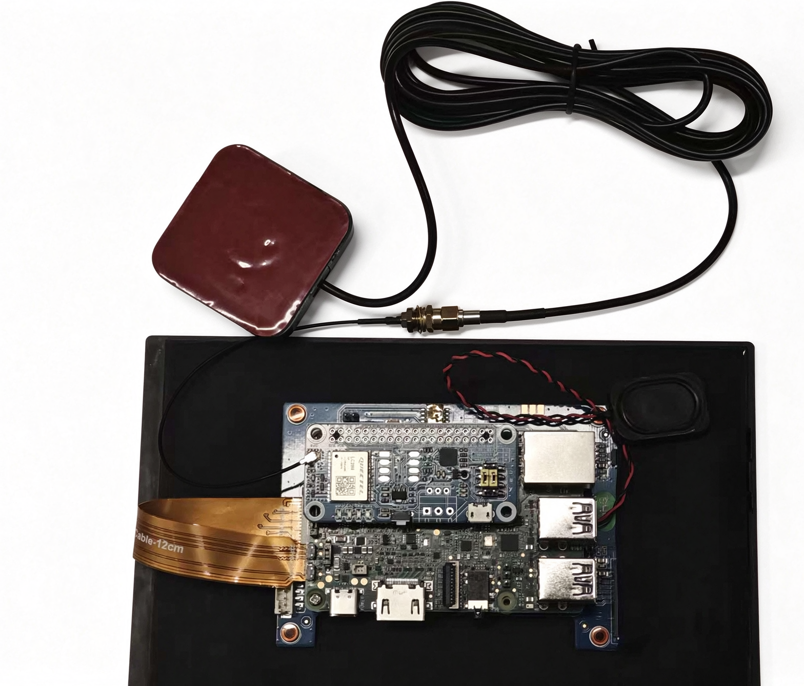

2. Position information

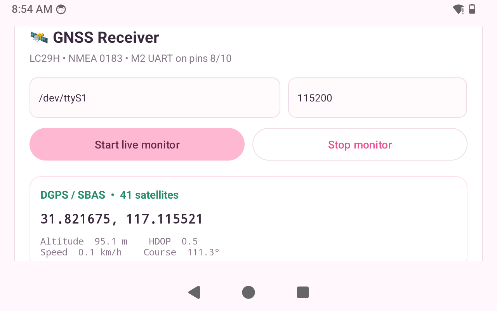

3. Map preview

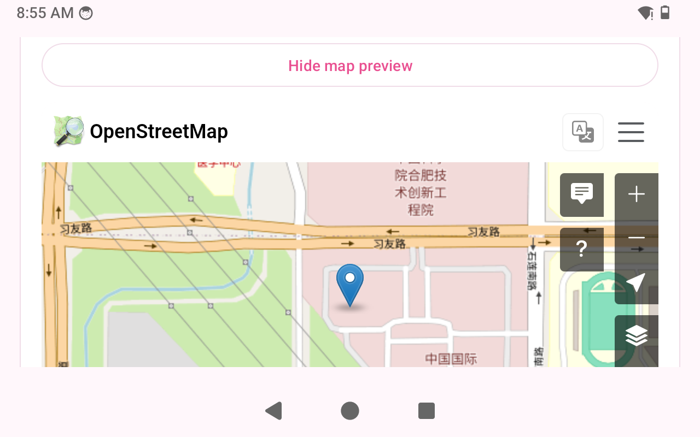

## SPI: SSD1305 OLED

The current SPI page controls the OLED; it is not a generic SPI transaction editor. The helper's M2 defaults are:

| Setting | Default |
|---|---|
| SPI device | `/dev/spidev1.0` |
| DC GPIO | 134 (header pin 18) |
| Reset GPIO | 76 (header pin 22) |
| Controller | SSD1305, 128×32 |

The UI accepts 1–21 printable ASCII characters. The helper validates the command, sets the M2 interface defaults, initializes the SDK, updates the display, and releases the module:

```c
if (setenv("OLED_SPI_DEV", "/dev/spidev1.0", 1) != 0 ||
    setenv("OLED_DC_GPIO", "134", 1) != 0 ||
    setenv("OLED_RST_GPIO", "76", 1) != 0) {
    perror("setting M2 OLED defaults");
    return 1;
}

if (DEV_ModuleInit() != 0) {
    DEV_ModuleExit();
    return 1;
}
SSD1305_begin();
SSD1305_clear();
SSD1305_string(0, 0, text, OLED_FONT_SIZE, 1);
SSD1305_display();
DEV_ModuleExit();
```

`board_io.c` also contains a generic SPI helper, but it is not connected to the UI.

### Result screenshots

1. Enter text in the app

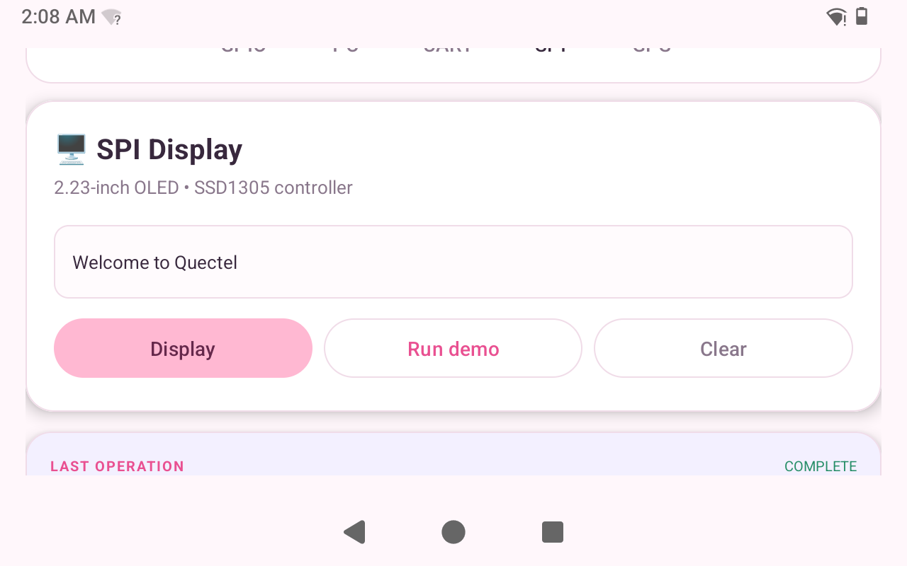

2. Text displayed on the OLED

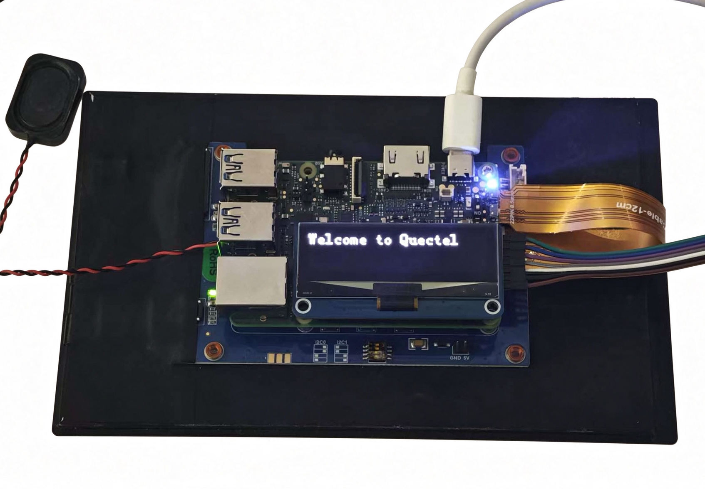

## Error handling and resource lifecycle

`runOperation` centralizes one-shot UI operations: it prevents duplicate submissions, shows RUNNING, dispatches work to the background worker, then displays COMPLETE or ERROR on the main thread:

```kotlin
hardware.runAsync(operation) { result ->
    operationBusy = false
    operationButtons.forEach { it.isEnabled = true }
    result.onSuccess { message ->
        resultText.text = message
        resultStatus.text = "COMPLETE"
    }.onFailure { error ->
        resultText.text = buildErrorMessage(error)
        resultStatus.text = "ERROR"
    }
}
```

GPIO outputs remain claimed by their helper processes; GPS uses a dedicated reader executor. When the Activity closes, `HardwareAccess.close()` stops GPS, releases GPIO outputs, cleans up processes, and shuts down its executors. UART and GPS restore termios settings; the SPI helper exits through the HAT SDK cleanup function. New hardware features should also define ownership, conflict handling, timeouts, error reporting, and a stop/close path.

## Extending the app

Keep the layers separate: **UI → input validation → `HardwareAccess` → C helper / HAT SDK → result parsing**.

### 1. UI and input validation

Add controls and strings, then bind them in the appropriate setup method. Put format/range checks in `HardwareInput` instead of directly concatenating user input into a shell command. For example, OLED text is restricted by length and character set:

```kotlin
fun oledText(raw: String): String {
    val text = raw.trim()
    require(text.isNotEmpty()) { "Enter text to display" }
    require(text.length <= 21) { "Text must be 21 characters or fewer" }
    require(text.all { it.code in 0x20..0x7E }) {
        "Only printable ASCII text is supported"
    }
    return text
}
```

### 2. Hardware access layer

Use `invokeExecutable()` / `invokeHelper()` for short commands; they install the helper, run it through `m2hw`, collect output, enforce timeouts, and reject non-zero exit codes. A long-running operation must retain its `Process` and provide an explicit stop path.

### 3. Native helper and output protocol

Implement generic GPIO/I²C/UART/GPS/SPI commands in `board_io.c` and route them through its command dispatcher. Put HAT-specific logic in a dedicated wrapper. Define a stable Kotlin/C protocol such as GPIO `READY` / `VALUE=...`, UART `RX=...`, or sensor `key=value`. Missing fields, error statuses, and non-zero exit codes must remain visible failures.

Save and restore original termios or SPI settings on every exit path. Close every successfully opened fd. After successful SDK initialization, call its matching cleanup function.

### 4. Tests and device validation

- `HardwareInputTest.kt`: GPIO mappings, invalid pins, device paths, HEX payloads, and OLED text bounds.
- `GpsNmeaParserTest.kt`: GGA/RMC, coordinate conversion, no-fix data, and invalid checksums.
- Run JVM unit tests for pure Kotlin logic and build native helpers with Gradle. Verify actual device nodes, permissions, readings, and resource release on an M2.

## Build, install, and device requirements

### Toolchain

- Android Studio or Android command-line build tools
- JDK 17
- Android SDK Platform 36 (API 36.1)
- Android Gradle Plugin 9.2.1 / Gradle Wrapper 9.4.1
- Android NDK `21.4.7075529`

From the project root on Windows:

```powershell
.\gradlew.bat testDebugUnitTest assembleRelease
adb install -r app\build\outputs\apk\release\app-release.apk
```

When local `signing.properties` and the root `quectel` keystore are present, Gradle automatically signs the **release** APK with that key. Debug builds continue to use Android's standard debug key. Both local signing files are ignored by Git and must not be committed; back up the keystore securely because future updates to an installed release must use the same key.

`local.properties` contains a machine-specific Android SDK path and should not be committed. The required C SDK trees and upstream license are included at:

```text
demo-40Pin-HAT/
├── Environment-Sensor-HAT/QPi_Environment_Sensor_HAT_SDK/c/
├── 2.23inch-OLED-HAT/QPi_2.23inch_OLED_HAT_SDK/c/
└── LICENSE
```

These SDK files come from [Quectel-Pi/demo-40Pin-HAT](https://github.com/Quectel-Pi/demo-40Pin-HAT) (`main` branch) and are distributed under the included Apache-2.0 `LICENSE`. Keep the license with the source. `DEV_Config.c/.h` have a small M2ControlDemo modification that exposes I²C transfer failures; the sensor helper is adapted to the current SDK's `imuInit()` API.

### Current limitations

- Only the configured Quectel M2 GPIO map, serial nodes, and HAT wiring are supported.
- The I²C page reads the known Environment Sensor HAT; it does not provide a generic scanner UI.
- The SPI page controls the SSD1305 OLED; it does not provide a generic SPI transaction UI.
- PWM, CAN, GPIO interrupt monitoring, and similar features are not integrated.
- The map is an online OpenStreetMap preview. It requires working network/DNS, and no offline map data is included.
- The M2 `m2hw` allowlist, system drivers, device nodes, and physical wiring are prerequisites; installing the APK does not configure system access.
- The current release lint task reports three `Instantiatable` errors for `MainActivity`, `MaterialCardView`, and `MaterialButton`; `assembleRelease` stops at that lint check. Packaging was verified with `-x :app:lintVitalRelease`; resolve the lint findings before publishing.
