# M2 Control Demo

[English](README.md) | **简体中文**

M2 40pin Control Demo 是一款面向 **Quectel M2（RK3576）40-pin 扩展接口**的 Android 外设验证应用。它用一个 APK 集中验证板上的 GPIO、I²C 传感器 HAT、UART、SPI OLED 和 LC29H GNSS 通路，并在 UI 中显示操作结果、状态和错误。

> **仅适配 Quectel M2。** 本项目中的 GPIO 编号、设备节点、HAT 接线和 `m2hw` 特权访问均针对 M2 系统。

## 功能概览

| 页面 | 功能                                                                   |
|---|----------------------------------------------------------------------|
| GPIO | 读取单个映射 GPIO；将单脚拉高/拉低并保持；释放单脚；ALL UP / ALL DOWN 控制全部拉高拉低；释放全部输出       |
| I²C | 读取 Environment Sensor HAT 上的 BME280、TSL2591、LTR390、SGP40 和 ICM-20948 |
| UART | 选择设备节点和波特率，发送并接收 UTF-8 文本，或仅接收数据                                     |
| SPI | 在 2.23 英寸 SSD1305 OLED 上显示文本、运行演示图案、清屏                               |
| GPS | 从 LC29H 读取 NMEA 串流，解析定位、卫星数、海拔、HDOP、速度和航向；在应用内预览在线 OpenStreetMap 地图  |

## 项目结构和数据流

```text
M2ControlDemo/
├── app/
│   ├── build.gradle.kts
│   └── src/
│       ├── main/
│       │   ├── java/com/quectel/m2controldemo/
│       │   │   ├── MainActivity.kt       页面、事件绑定、结果和地图预览
│       │   │   ├── HardwareAccess.kt     特权 helper、后台任务和硬件资源生命周期
│       │   │   ├── HardwareInput.kt      M2 引脚映射、输入校验和字节编码
│       │   │   └── GpsNmeaParser.kt      NMEA checksum 和定位字段解析
│       │   ├── cpp/
│       │   │   ├── board_io.c            GPIO、I²C、UART、GPS、SPI 通用 helper
│       │   │   ├── sensor_hat.c          Environment Sensor HAT SDK 封装
│       │   │   └── oled_hat.c            SSD1305 OLED SDK 封装
│       │   ├── res/                      布局、图标、颜色和英文文案
│       │   └── assets/                   由 Gradle 构建任务生成并打包的 helper
│       └── test/                         输入校验和 NMEA 解析的 JVM 单元测试
├── demo-40Pin-HAT/                       Quectel HAT SDK 源码和许可证
├── gradle/libs.versions.toml
└── gradlew.bat
```

一次性操作的调用链：

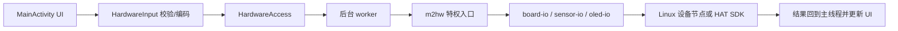

Activity 不直接操作 `/dev/gpiochip*`、`/dev/i2c-*`、`/dev/tty*` 或 `/dev/spidev*`。它先校验输入，再让 `HardwareAccess` 调用 helper。一次性命令经单线程 executor 执行，完成后将 `Result<String>` 回调到主线程。GPS 则使用专用 reader executor 持续读取串口。

## M2 特权硬件访问

应用将 APK assets 中的 `board-io`、`sensor-io`、`oled-io` 复制到 `/data/local/tmp/m2controldemo/`，设置可执行权限，再经由 M2 系统的 `m2hw` 通道执行。代码中的关键命令构造如下：

```kotlin
private fun startRootProcess(command: String): Process {
    val process = ProcessBuilder("m2hw", "0", "sh", "-c", command)
        .redirectErrorStream(true)
        .start()
    processes.add(process)
    return process
}
```

APK 不依赖在应用内调用 `su`。设备系统必须允许该应用通过 `m2hw` allowlist 使用该入口，并提供对应驱动和设备节点；普通 Android 设备不会因安装 APK 而获得这些硬件权限。

资源和错误处理遵循同一原则：命令超时会终止进程；退出码或 helper 输出异常会作为错误显示；持续运行的 helper 有明确停止路径。`HardwareAccess.close()` 会停止 GPS、释放保持中的 GPIO 进程并关闭 executor。

## GPIO：M2 物理 pin 映射、输出和释放

M2 物理 pin 到 Linux 全局 GPIO 的映射保存在 `HardwareInput.m2Pins`。目前映射了 28 个 GPIO：

| 物理 pin | GPIO | 物理 pin | GPIO |
|---:|---:|---:|---:|
| 3 | 140 | 5 | 141 |
| 7 | 79 | 8 | 72 |
| 10 | 73 | 11 | 78 |
| 12 | 87 | 13 | 70 |
| 15 | 71 | 16 | 132 |
| 18 | 134 | 19 | 82 |
| 21 | 83 | 22 | 76 |
| 23 | 85 | 24 | 84 |
| 26 | 81 | 27 | 97 |
| 28 | 96 | 29 | 93 |
| 31 | 92 | 32 | 77 |
| 33 | 91 | 35 | 86 |
| 36 | 90 | 37 | 95 |
| 38 | 88 | 40 | 89 |

映射数值转换为 GPIO chip 和 line 的方式：

```kotlin
fun gpioForPin(raw: String): Pair<Int, Int> {
    val pin = decimal("Physical pin", raw, 1, 40)
    val gpio = m2Pins[pin]
        ?: throw IllegalArgumentException("Pin $pin is not a supported M2 GPIO")
    return (gpio / 32) to (gpio % 32)
}
```

例如，全局 GPIO 140 对应 `/dev/gpiochip4` 的 line 12。物理电源脚和地线没有加入映射，因此不能作为 GPIO 操作。

Activity 的一次单脚输出路径先解析并校验 pin，再调用硬件层：

```kotlin
private fun setGpioOutput(high: Boolean) {
    runOperation {
        val pin = HardwareInput.decimal("Physical pin", textOf(R.id.gpio_pin), 1, 40)
        val (chip, line) = HardwareInput.gpioForPin(pin.toString())
        hardware.setGpio(pin, chip, line, high)
    }
}
```

原生 helper 通过 GPIO character-device ioctl 请求线路。成功后输出 `READY` 并保持进程运行；进程持有 line fd 时电平保持，关闭进程会释放线路：

```c
line_fd = request_gpio_v2(chip_fd, line, output, initial_value);
if (line_fd < 0) {
    line_fd = request_gpio_v1(chip_fd, line, output, initial_value);
}
if (line_fd < 0) {
    report_errno("request GPIO line (v2 and v1)");
    goto done;
}

if (output) {
    char buffer[256];
    if (fputs("READY\n", stdout) == EOF || fflush(stdout) == EOF) {
        report_errno("stdout");
        goto done;
    }
    for (;;) {
        ssize_t count = read(STDIN_FILENO, buffer, sizeof(buffer));
        if (count == 0) break;
        if (count < 0 && errno == EINTR) continue;
        if (count < 0) {
            report_errno("stdin");
            goto done;
        }
    }
}
```

`HardwareAccess` 等待 `READY` 后保存该进程；释放时关闭 helper 的 stdin 并等待进程退出。ALL UP / ALL DOWN 使用同一机制逐个请求全部 28 条线路，操作前显示确认框；中途失败会释放本次已成功申请的线路。

**注意：** 批量拉高/拉低会真实改变 28 个 GPIO 的电平。使用前断开可能受损的外部电路，并确认引脚方向、电压和外部连接；需要时用 RELEASE ALL 归还线路。

### 结果展示

1、外设接线展示
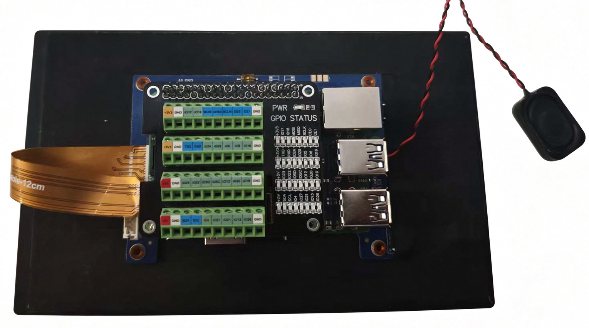

2、GPIO引脚全部拉低
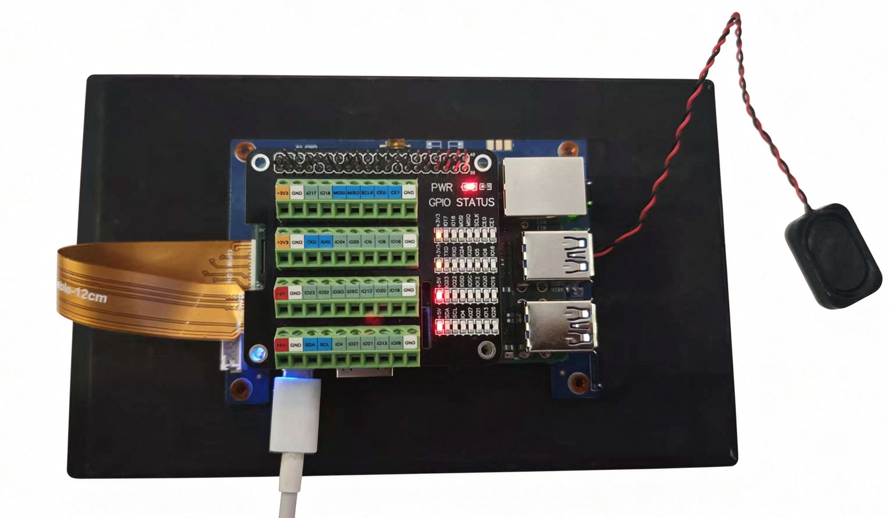

3、GPIO引脚全部拉高
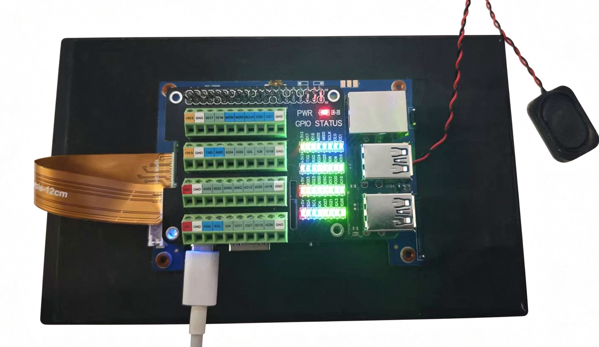

## I²C：Environment Sensor HAT

I²C 页读取固定的 Environment Sensor HAT（M2 使用 bus 3），不是通用 I²C 地址扫描器或寄存器编辑器。

| 器件 | 应用显示内容 |
|---|---|
| BME280 | 温度、湿度、气压 |
| TSL2591 | 光照度 |
| LTR390 | UV 原始读数 |
| SGP40 | VOC 原始值及读取状态 |
| ICM-20948 | 加速度、陀螺仪；可用时包括姿态角和磁力计 |

`sensor_hat.c` 通过 HAT SDK 初始化和采样，并输出由 Kotlin 解析的 `key=value` 协议。Kotlin 会检查必需字段和器件状态，而不是在字段缺失时伪造数值。例如原生输出类似：

```text
pressure=1008.42
temperature=24.18
humidity=42.30
lux=87
uv=13
voc_status=ok
voc=12345
imu_status=ok
accel_x=...
gyro_x=...
roll=...
```

Kotlin 将每行按第一个 `=` 拆成键和值，再检查必需字段；这种小型协议让 C helper 与 UI 格式化逻辑保持解耦：

```kotlin
val values = output.lineSequence().mapNotNull { line ->
    val separator = line.indexOf('=')
    if (separator <= 0) null
    else line.substring(0, separator) to line.substring(separator + 1)
}.toMap()
val requiredKeys = listOf(
    "pressure", "temperature", "humidity", "lux", "uv", "voc_status", "imu_status"
)
val missing = requiredKeys.filterNot(values::containsKey)
if (missing.isNotEmpty()) {
    throw IOException("Incomplete sensor data: ${missing.joinToString()}")
}
```

VOC / IMU 可分别返回 `read_failed`、`not_detected`、`initialization_failed` 或 `mag_unavailable` 状态。SDK 调试输出会与机器可读结果分离；所有退出路径调用 `DEV_ModuleExit()`。`board_io.c` 中也实现了通用 I²C 读写命令，但尚未接入应用 UI。

### 结果展示
1、 外设接线展示
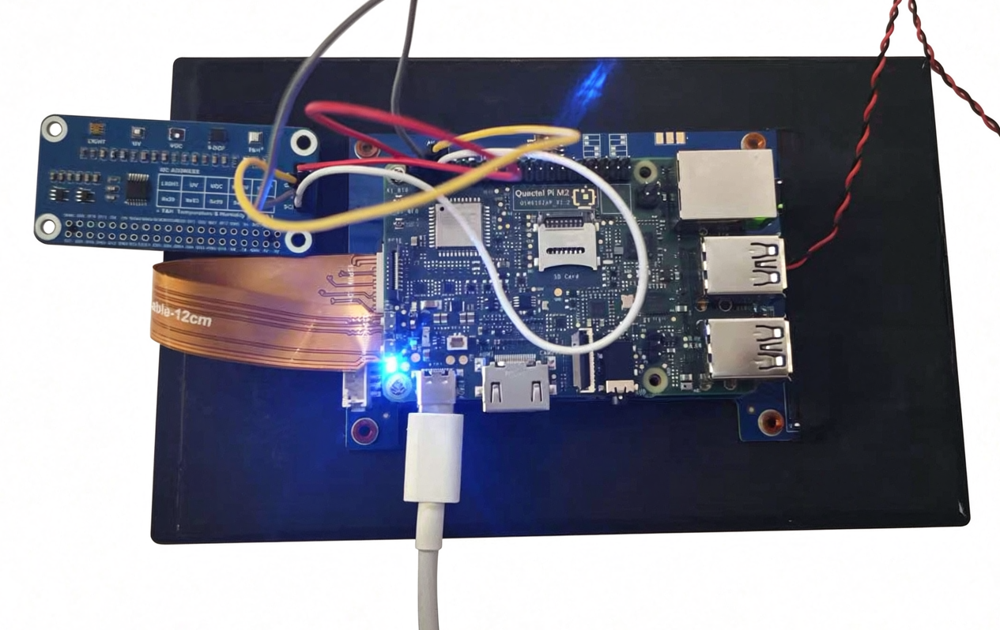

2、 I²C读取结果
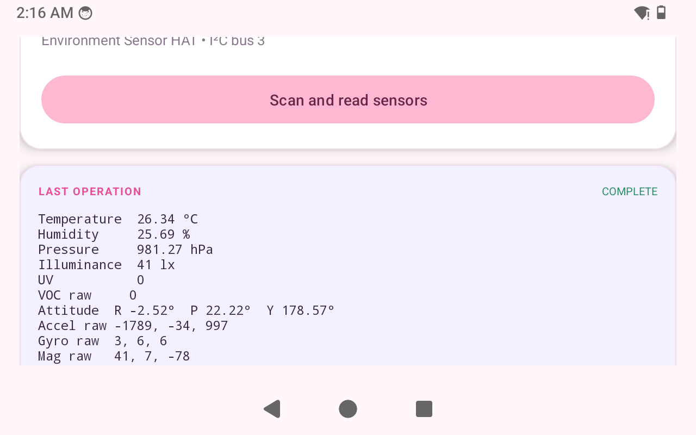

## UART：发送、接收和环回测试

UART 输入在 Kotlin 层校验设备节点和波特率。波特率从应用支持集合选择，串口路径限制为 `/dev/tty...`，payload 转换为 HEX 后传给 native helper：

```kotlin
val device = HardwareInput.uartDevice(textOf(R.id.uart_device))
val baud = parseBaudRate()
val payload = textOf(R.id.uart_message).toByteArray(Charsets.UTF_8)
require(payload.isNotEmpty()) { "Enter a message to send" }
hardware.transferUart(device, baud, 1800, HardwareInput.toHex(payload))
```

“Receive only” 调用相同硬件层但不传 TX payload，UI 使用 5 秒超时。Helper 临时设置 raw 8N1；关键点是先保存 termios，退出时恢复并关闭 fd：

```c
if (tcgetattr(fd, &original) != 0) {
    report_errno("tcgetattr");
    goto done;
}
configured = original;
cfmakeraw(&configured);
configured.c_cflag |= CLOCAL | CREAD;
configured.c_cflag &= ~(CSTOPB | PARENB | CSIZE);
configured.c_cflag |= CS8;
if (cfsetispeed(&configured, speed) != 0 ||
    cfsetospeed(&configured, speed) != 0) {
    report_errno("set UART speed");
    goto done;
}
restore_needed = 1;
if (tcsetattr(fd, TCSANOW, &configured) != 0) {
    report_errno("tcsetattr");
    goto done;
}

done:
    if (restore_needed && have_original &&
        tcsetattr(fd, TCSANOW, &original) != 0) {
        report_errno("restore termios");
        result = 1;
    }
    if (fd >= 0) close(fd);
```

Helper 以 `RX=<HEX>` 返回接收字节，Kotlin 验证并解码后显示 HEX 和可读文本。物理 UART 环回需要连接 **物理 pin 8（TX）到 pin 10（RX）**。GPS 使用 `/dev/ttyS1` 时，应用会拒绝在 GPS 正占用的同一节点上运行 UART 测试。

### 结果展示

1、UART回环测试结果（需短接pin8 pin10引脚）
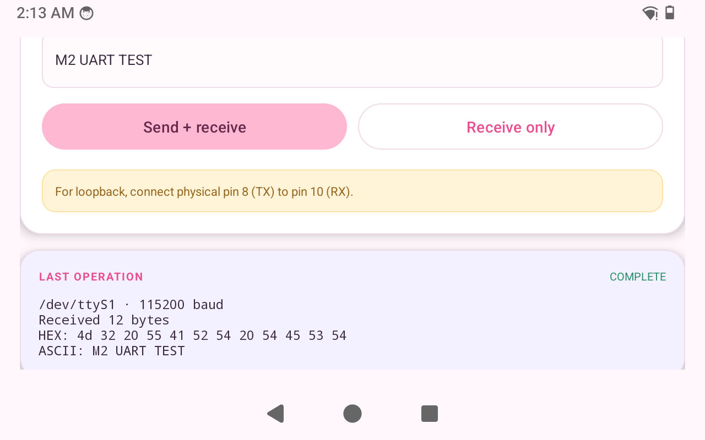

## GPS：LC29H、NMEA 解析和地图预览

默认串口为 `/dev/ttyS1`、115200 baud。GPS 是持续数据流，硬件层启动 `board-io gps-stream DEVICE BAUD`，收到 `GPS_READY` 后才报告启动成功。C helper 将串口设为 raw 8N1，按 NMEA 行输出；停止时恢复原 termios 并关闭串口 fd。

`GpsNmeaParser` 首先验证 `$...*HH` checksum，再解析 GGA 和 RMC。checksum 核心逻辑：

```kotlin
private fun checkedFields(sentence: String): List<String>? {
    if (!sentence.startsWith('$')) return null
    val star = sentence.lastIndexOf('*')
    if (star <= 1 || star + 3 != sentence.length) return null
    val expected = sentence.substring(star + 1).toIntOrNull(16) ?: return null
    var checksum = 0
    for (index in 1 until star) checksum = checksum xor sentence[index].code
    if (checksum != expected) return null
    return sentence.substring(1, star).split(',')
}
```

NMEA 坐标采用“度 + 分”格式，转换为十进制度。实际解析还校验分值、经纬度范围和方向：

```kotlin
private fun coordinate(value: String, hemisphere: String, latitude: Boolean): Double? {
    val raw = value.toDoubleOrNull()?.takeIf(Double::isFinite) ?: return null
    if (raw < 0) return null
    val degrees = floor(raw / 100.0)
    val minutes = raw - degrees * 100.0
    if (minutes !in 0.0..<60.0) return null
    val limit = if (latitude) 90.0 else 180.0
    if (degrees > limit || (degrees == limit && minutes != 0.0)) return null
    val direction = hemisphere.uppercase()
    if (latitude && direction !in setOf("N", "S")) return null
    if (!latitude && direction !in setOf("E", "W")) return null
    val decimal = degrees + minutes / 60.0
    return if (direction == "S" || direction == "W") -decimal else decimal
}

speedKmh = if (hasFix) {
    fields[7].toDoubleOrNull()?.takeIf(Double::isFinite)?.times(1.852)
} else {
    null
}
```

无效 checksum 增加 rejected 计数但不覆盖最近一次有效位置。UI 每约 1.5 秒更新一次，避免串口每行数据都触发重绘。停止按钮或 Activity 销毁会停止 helper，避免串口遗留占用。

获得定位后，地图按钮在应用内 WebView 打开以当前坐标为中心的 OpenStreetMap 在线页面。应用没有打包离线地图；地图需要网络和可用 DNS，显示地图时所选坐标会发送给 OpenStreetMap。WebView 禁止 file/content access，Activity 暂停和销毁时执行相应生命周期清理。无网络时显示应用内错误状态。

### 结果展示

1. 外设连接

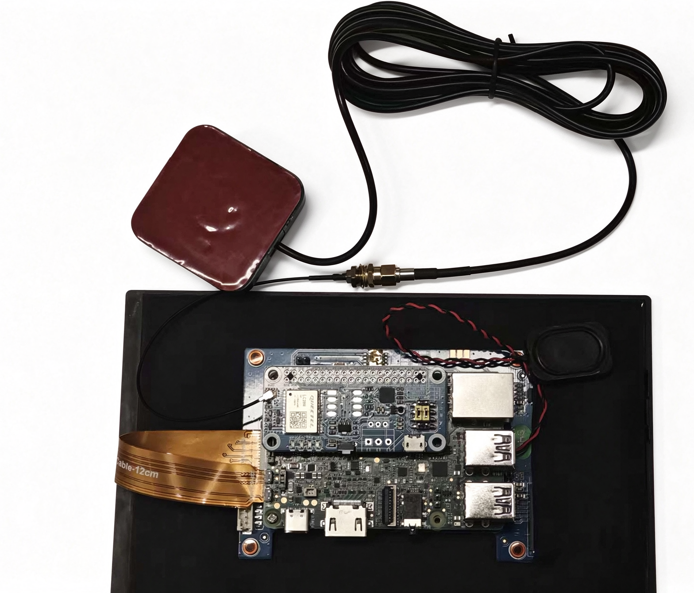


2. 获取位置信息


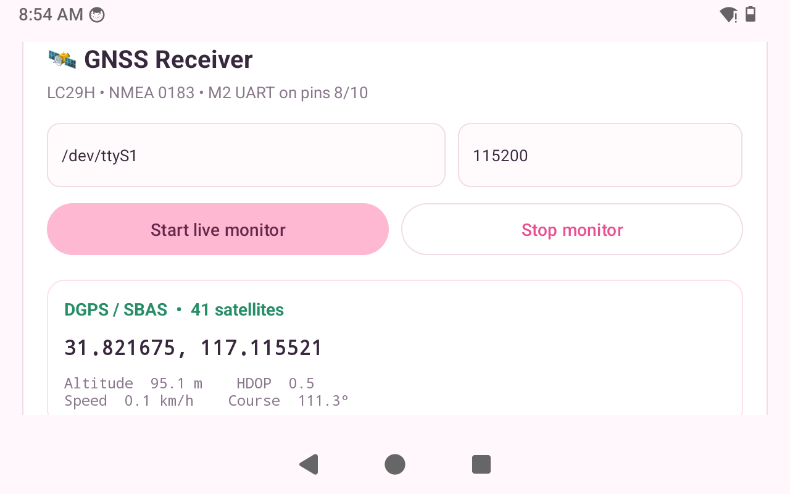


3. 地图预览


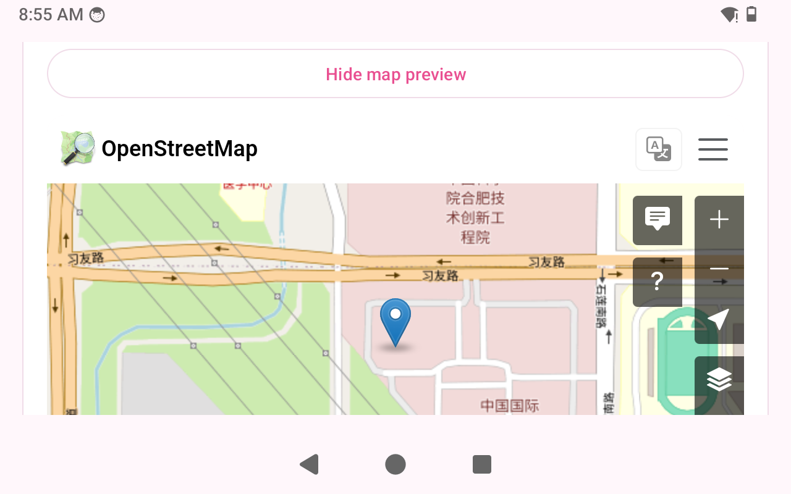


## SPI：SSD1305 OLED

当前 SPI 页面是 OLED 专用控制界面，不是任意 SPI 事务编辑器。OLED helper 为 M2 设置的默认值：

| 参数 | 默认值 |
|---|---|
| SPI 设备 | `/dev/spidev1.0` |
| DC GPIO | 134（物理 pin 18） |
| Reset GPIO | 76（物理 pin 22） |
| 控制器 | SSD1305，128×32 |

UI 只允许 1–21 个可打印 ASCII 字符。helper 的主要流程是校验命令、设置 M2 默认接口、初始化、操作显示并释放 SDK：

```c
if (setenv("OLED_SPI_DEV", "/dev/spidev1.0", 1) != 0 ||
    setenv("OLED_DC_GPIO", "134", 1) != 0 ||
    setenv("OLED_RST_GPIO", "76", 1) != 0) {
    perror("setting M2 OLED defaults");
    return 1;
}

if (DEV_ModuleInit() != 0) {
    DEV_ModuleExit();
    return 1;
}
SSD1305_begin();
SSD1305_clear();
SSD1305_string(0, 0, text, OLED_FONT_SIZE, 1);
SSD1305_display();
DEV_ModuleExit();
```

`board_io.c` 还包含通用 SPI helper，但目前没有连接到 UI。

### 结果展示

1、apk界面输入文本
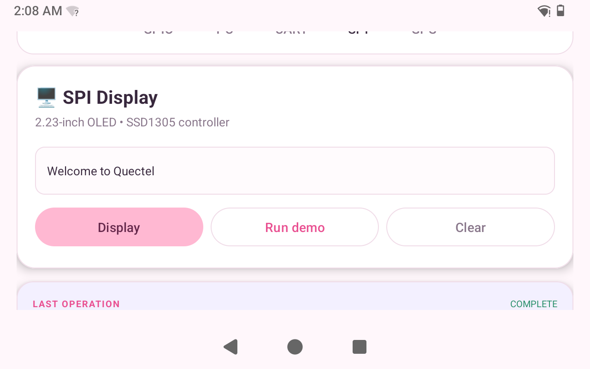

2、OLED显示效果
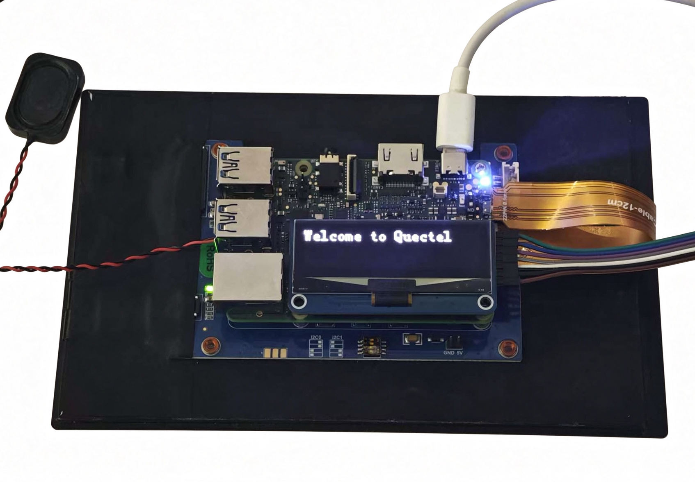

## 错误处理和资源生命周期

普通单次操作由 `runOperation` 统一管理：阻止重复提交、显示 RUNNING 状态、通过后台 worker 执行并在 UI 线程显示 COMPLETE / ERROR：

```kotlin
hardware.runAsync(operation) { result ->
    operationBusy = false
    operationButtons.forEach { it.isEnabled = true }
    result.onSuccess { message ->
        resultText.text = message
        resultStatus.text = "COMPLETE"
    }.onFailure { error ->
        resultText.text = buildErrorMessage(error)
        resultStatus.text = "ERROR"
    }
}
```

持续运行的 GPIO 输出通过持有 helper 进程保持 line request；GPS 使用独立 reader executor。关闭 Activity 时 `HardwareAccess.close()` 停止 GPS、释放 GPIO 输出、清理进程并关闭线程池。UART 和 GPS helper 在退出时恢复 termios；SPI helper 经 SDK 退出函数清理设备。新增硬件功能时，也应明确所有权、冲突策略、超时、错误输出和 stop/close 路径。

## 如何扩展一个硬件功能

建议维持“UI → 输入校验 → HardwareAccess → C helper / HAT SDK → 结果解析”的边界。

### 1. UI 和输入校验

新增控件与字符串后，在对应 setup 方法绑定事件。输入格式和范围集中放进 `HardwareInput`，避免把用户文本直接拼接成 shell 命令。例如 OLED 限制字符集和长度：

```kotlin
fun oledText(raw: String): String {
    val text = raw.trim()
    require(text.isNotEmpty()) { "Enter text to display" }
    require(text.length <= 21) { "Text must be 21 characters or fewer" }
    require(text.all { it.code in 0x20..0x7E }) {
        "Only printable ASCII text is supported"
    }
    return text
}
```

### 2. 硬件访问层

短命令使用 `invokeExecutable()` / `invokeHelper()`，由它们负责安装 helper、调用 `m2hw`、收集输出、处理超时和非零退出码。长期命令必须保存 `Process`，并实现明确的停止路径。

### 3. Native helper 和输出协议

通用 GPIO/I²C/UART/GPS/SPI 放在 `board_io.c` 并接入命令分派；HAT 专用代码放独立 wrapper。Kotlin 和 C 之间约定稳定协议，例如 GPIO 的 `READY` / `VALUE=...`、UART 的 `RX=...`、传感器的 `key=value`。任何缺字段、错误状态或非零退出码都必须作为失败展示。

修改 termios 或 SPI 参数时先保存原值，所有退出路径均尝试恢复；每个成功打开的 fd 都要关闭。SDK 初始化成功后须在清理路径调用对应退出函数。

### 4. 测试和设备验证

- `HardwareInputTest.kt`：测试 GPIO 映射、非法 pin、设备路径、HEX payload 和 OLED 文本限制。
- `GpsNmeaParserTest.kt`：测试 GGA/RMC、经纬度转换、无定位和错误 checksum。
- 纯 Kotlin 逻辑运行 JVM 单元测试；native helper 需要通过 Gradle 构建；设备节点、权限、实际传感器读数和资源释放必须在 M2 上验证。

## 构建、安装与设备要求

### 工具链

- Android Studio 或 Android command-line build tools
- JDK 17
- Android SDK Platform 36（API 36.1）
- Android Gradle Plugin 9.2.1 / Gradle Wrapper 9.4.1
- Android NDK `21.4.7075529`

### 当前边界

- 仅支持文档/代码中配置的 Quectel M2 GPIO、串口和 HAT 接线。
- I²C 页面读取固定 Environment Sensor HAT，不提供通用扫描器 UI。
- SPI 页面控制 SSD1305 OLED，不提供通用 SPI 事务 UI。
- 未集成 PWM、CAN、GPIO 中断监听等功能。
- 地图是在线 OpenStreetMap 预览；网络/DNS 不可用时不能显示瓦片，且没有离线地图数据。
- M2 `m2hw` allowlist、系统驱动、设备节点和实际布线是设备端运行前提；APK 安装本身不会配置系统权限。
- 当前 Release lint 检查对 `MainActivity`、`MaterialCardView` 和 `MaterialButton` 报告 3 个 `Instantiatable` 错误，因此标准 `assembleRelease` 会停在 lint 阶段。已通过 `-x :app:lintVitalRelease` 验证 APK 可打包；正式发布前应解决这些 lint 报告。
